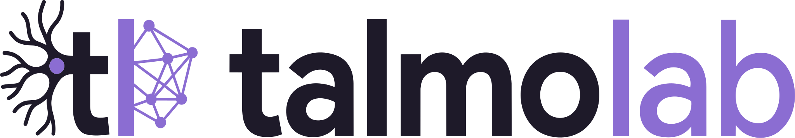
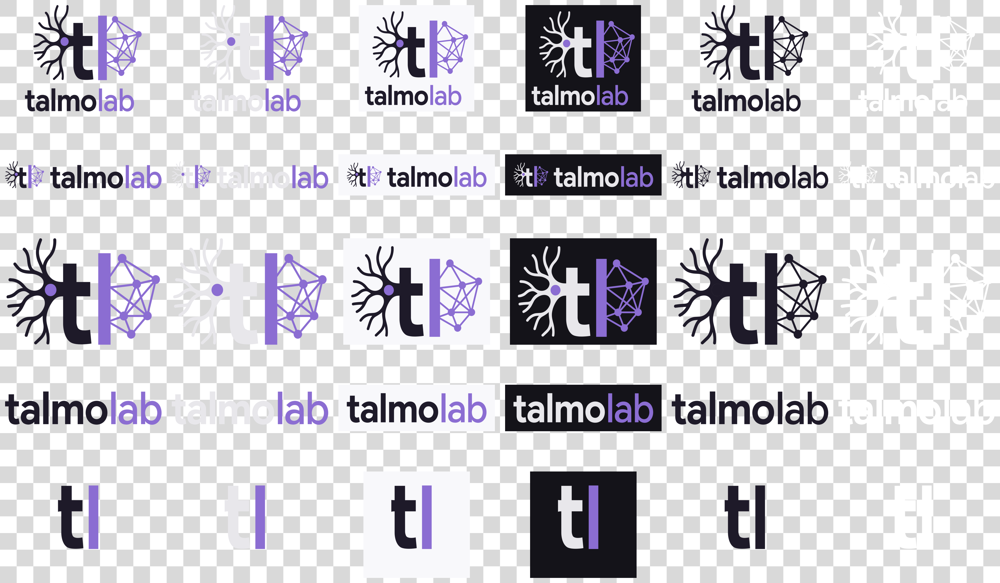

<p align="center">
  <picture>
    <source media="(prefers-color-scheme: dark)" srcset="svg/talmolab-lockup-h-dark.svg">
    
  </picture>
</p>

# Talmo Lab brand kit

The lab's logo in every shape and colour, its palette and typeface, and the scripts that
generate all of it. If you need a logo for a poster, a slide, a lab T-shirt or a profile
picture, start with the table below.

- [Which file do I need?](#which-file-do-i-need)
- [The logo](#the-logo): what it is, its shapes and colourways
- [Rules](#rules): clear space, minimum sizes, what not to do
- [Colours](#colours) and [type](#type)
- [Working on the kit](#working-on-the-kit): regenerating files, the site's copies

---

## Which file do I need?

**Prefer the SVG** whenever the app takes it (Illustrator, Inkscape, Figma, PowerPoint,
Keynote, the web): it is sharp at any size. Use a PNG only when
it doesn't (Google Slides, Word on some platforms, most upload forms).

| I'm making… | Use | Why |
|---|---|---|
| A poster or printed handout on white | [`svg/talmolab-lockup-light.svg`](svg/talmolab-lockup-light.svg) | Stacked lockup, vector, any size |
| A poster header band or a page footer | [`svg/talmolab-lockup-h-light.svg`](svg/talmolab-lockup-h-light.svg) | Horizontal, fits a strip |
| Slides with a light background | [`svg/talmolab-lockup-h-light.svg`](svg/talmolab-lockup-h-light.svg) · PNG: [`png/talmolab-lockup-h-light-1024.png`](png/talmolab-lockup-h-light-1024.png) | Transparent, ink and violet |
| Slides with a dark background | [`svg/talmolab-lockup-h-dark.svg`](svg/talmolab-lockup-h-dark.svg) · PNG: [`png/talmolab-lockup-h-dark-1024.png`](png/talmolab-lockup-h-dark-1024.png) | Light ink, same violet |
| A logo over a photo or a coloured background | [`svg/talmolab-lockup-mono-white.svg`](svg/talmolab-lockup-mono-white.svg) | All white, reads on anything dark or busy |
| One-colour printing: T-shirts, embroidery, stamps, engraving | [`svg/talmolab-lockup-mono-ink.svg`](svg/talmolab-lockup-mono-ink.svg) | All ink, one spot colour |
| A Word or Google Doc letterhead | [`png/talmolab-lockup-h-light-512.png`](png/talmolab-lockup-h-light-512.png) | Small, transparent |
| An email signature | [`png/talmolab-lockup-h-on-paper-512.png`](png/talmolab-lockup-h-on-paper-512.png) | Opaque, so dark-mode mail clients don't swallow the ink |
| A profile picture (GitHub, Slack, Zenodo, ORCID, Bluesky) | [`png/talmolab-lockup-square-on-paper-1024.png`](png/talmolab-lockup-square-on-paper-1024.png) | Padded to a true square so circular crops keep the whole name |
| A tiny square icon (under ~64 px) | [`favicon/talmolab-favicon-on-paper-512.png`](favicon/talmolab-favicon-on-paper-512.png) | The simplified `tl` cut, built to survive small sizes |
| An app icon or a larger square tile | [`og/talmolab-icon-512.png`](og/talmolab-icon-512.png) | Full mark on paper |
| A link preview / social card | [`og/talmolab-og-light-1200x630.png`](og/talmolab-og-light-1200x630.png) | 1200 × 630, what the website itself uses |
| A print shop that wants PDF or EPS | Open the SVG in Illustrator or Inkscape and save as PDF, or send [`talmolab-logo.v003.ai`](talmolab-logo.v003.ai) | The SVGs are the vector source of truth |

Every file is named `talmolab-<shape>-<colourway>[-<width>].<ext>`, so once you know the
shape and colourway below you can find any other combination in `svg/` or `png/`.

<p align="center">
  <a href="contact-sheet.png"></a>
  <br><sub>Every shape in every colourway. Checkerboard = transparent. Also on <a href="contact-sheet-white.png">plain white</a>.</sub>
</p>

---

## The logo

The mark is built from the two letters of the lab's initials, **t** and **l**, and from the
two things the lab studies:

- the **t** grows a neuron's **dendritic arbor**, drawn in ink;
- the **l** is a solid violet bar carrying a **pose skeleton**, the keypoint graph that
  behaviour-tracking software draws over an animal, plus the violet **soma** dot where the
  arbor meets the t.

The wordmark repeats the split: “talmo” in ink, “lab” in violet. That is the whole system:
**two colours, ink and violet, and nothing else.**

### Shapes

| Shape | What it is | Use it for |
|---|---|---|
| `lockup` | mark above wordmark | posters, title slides, anything with room |
| `lockup-h` | mark beside wordmark | headers, footers, slide corners, letterheads (the website's header) |
| `lockup-square` | stacked lockup padded to 1:1 | **avatars only**: uploaders that crop to a square or circle |
| `mark` | mark alone | where the name is already nearby; not below 32 px |
| `wordmark` | “talmolab” alone | rare; where the mark would be too detailed |
| `favicon` | simplified `tl`, no arbor or skeleton | browser tabs and anything under 32 px |

In the horizontal lockup the wordmark is scaled so its `l` exactly matches the mark's
violet bar, top and baseline, which is why the two read as one unit.

### Colourways

The violet is the same `#8b6dd2` in every colourway; only the ink changes.

| Suffix | Ink | Violet | Background | Use on |
|---|---|---|---|---|
| `-light` | `#1e1a29` | `#8b6dd2` | transparent | white or light backgrounds (the default) |
| `-dark` | `#e8e7eb` | `#8b6dd2` | transparent | black or dark backgrounds |
| `-on-paper` | `#1e1a29` | `#8b6dd2` | `#f8f8fb` | anywhere transparency is lost or unreliable |
| `-on-ground` | `#e8e7eb` | `#8b6dd2` | `#141319` | the same, dark |
| `-mono-ink` | `#1e1a29` | `#1e1a29` | transparent | one-colour print, fax, embroidery |
| `-mono-white` | `#ffffff` | `#ffffff` | transparent | photographs and coloured backgrounds |

### Sizes on disk

- **SVG** (`svg/`): every shape × colourway, tightly cropped, no margin.
- **PNG** (`png/`): 512 and 1024 px wide (the mark also at 256). For anything larger, use
  the SVG; `scripts/raster.py` also makes 2048 px versions on demand.
- **Favicons** (`favicon/`): the simplified cut at 16–512 px square, plus `favicon.ico`.
- **Cards and app icons** (`og/`): see [Link previews and app icons](#link-previews-and-app-icons).

---

## Rules

1. **Never type “talmolab”.** Not in a heading, a slide title or on a sign. Place the
   logo file: its letters are drawn outlines, not a font. In running text, the lab is
   **Talmo Lab**.
2. **Leave clear space** of at least 23% of the logo's height on every side (below).
3. **Respect the minimum sizes** (below).
4. **Match the colourway to the background**: `-light` on light, `-dark` on dark,
   `-mono-white` on photos. If the logo looks faint, you have the wrong one.
5. **Don't alter it.** No other colours, gradients, outlines, shadows or glows; no
   stretching, rotating or rearranging the mark and the wordmark; no redrawn letters.
6. **Don't add a second accent colour** next to it. Violet is the only colour beside ink
   and paper.

### Clear space

The unit is **`b`, the width of the violet bar**. Keep **`2b` clear on all four sides**,
which works out to **0.232 × the logo's height**.

| Logo height | Clear space each side |
|---|---|
| 38 px (website header) | 9 px |
| 80 px | 19 px |
| 120 px | 28 px |
| 2 cm | 4.6 mm |
| 5 cm | 11.6 mm |

The SVGs and transparent PNGs are cropped tight, so the clear space has to come from your
layout. The `-on-paper` and `-on-ground` tiles include a small margin, but less than `2b`.
[`clear-space.png`](clear-space.png) shows the rule and the common mistakes.

### Minimum sizes

Measured as on-screen height at normal (1×) pixel density.

| Shape | Smallest | Smaller than that? |
|---|---|---|
| `lockup` | 64 px tall | switch to `lockup-h` |
| `lockup-h` | 24 px tall | switch to the favicon cut |
| `mark` | 32 px tall | switch to the favicon cut |
| `wordmark` | 12 px tall | switch to `lockup-h` |
| `favicon` | 16 px | nothing smaller |

Below 32 px the arbor and skeleton blur into noise, which is why the favicon keeps only
the `t` and the bar ([`favicon-simplified.png`](favicon-simplified.png) compares them).

---

## Colours

### Brand colours

| Name | Hex | RGB | Used for |
|---|---|---|---|
| **Ink** | `#1e1a29` | 30 26 41 | the `t`, the arbor, “talmo”; body text |
| **Violet** | `#8b6dd2` | 139 109 210 | the bar, the skeleton, the soma, “lab” |
| **Paper** | `#f8f8fb` | 248 248 251 | light background |
| **Ground** | `#141319` | 20 19 25 | dark background |
| **Light ink** | `#e8e7eb` | 232 231 235 | the logo's ink and body text on dark |

Ink and violet share a hue (about 295°), so the logo reads as one colour family at two
lightnesses rather than two competing colours.

### Violet is not a text colour

The logo violet `#8b6dd2` is only **3.8 : 1** against paper, below the 4.5 : 1 that
accessible text needs. So:

- use **`#8b6dd2`** for the logo and for non-text marks (rules, dots, chart accents);
- use **`#805fc9`** for violet **text and links on light** backgrounds (4.50 : 1);
- use **`#8c6bd6`** for violet text and links on dark backgrounds (4.56 : 1).

The logo itself never switches: it is `#8b6dd2` on both light and dark.

### Full palette

These are the website's colours, also in [`palette.css`](palette.css) as CSS custom
properties. Contrast is against that theme's background.

| Token | Light | Dark | Used for |
|---|---|---|---|
| `paper` | `#f8f8fb` | `#141319` | page background |
| `sunk` | `#f0eff4` | `#1c1b22` | recessed panels |
| `rule` | `#dedde3` | `#2c2a31` | dividers and borders |
| `text` | `#1e1a29` (16.0 : 1) | `#e8e7eb` (15.0 : 1) | body text |
| `muted` | `#5c5965` (6.5 : 1) | `#abaab1` (8.0 : 1) | captions, metadata |
| `link` | `#805fc9` (4.5 : 1) | `#8c6bd6` (4.6 : 1) | links and accent text |
| `mark` | `#8b6dd2` (3.8 : 1) | `#8b6dd2` (4.6 : 1) | logo and non-text marks only |

---

## Type

**[Source Sans 3](https://fonts.google.com/specimen/Source+Sans+3)**, and nothing else:
weights 400, 500 and 600 with italics. No serif, no monospace. Use 600 for headings (there
is no bold 700 in the system) and tabular figures where numbers line up in columns.

It was chosen for coverage of what the lab actually writes: Vietnamese names, Greek and
mathematical symbols. [`type.css`](type.css) has the face and the website's type scale.

On slides and posters, set titles and body in Source Sans 3 and let the logo file supply
“talmolab”.

---

## Working on the kit

Everything here is generated from one master, so change the master and rerun the scripts;
never hand-edit an export.

```
brand/
  talmolab-logo.v003.ai        Illustrator source
  talmolab-logo.v003.svg       master SVG (normalised export) that every script reads
  talmolab-logo.v003.svg.orig  raw Illustrator export, before normalising
  palette.css, type.css        colour tokens and type spec
  svg/  png/  favicon/  og/    the exports
  contact-sheet*.png           every variant in one grid
  clear-space.png, favicon-simplified.png   rule diagrams
  scripts/                     the generators
```

### Regenerating

Needs Python 3, Google Chrome at `/Applications/Google Chrome.app` (change `CHROME` at the
top of each script to move it) and ImageMagick's `magick` on the path.

```bash
cd brand/scripts
python3 mkassets.py      # all SVGs, and variants.json
python3 raster.py        # all PNGs and favicon.ico  (raster.py lockup-h: one shape only)
python3 mkog.py          # link-preview cards and app icons
python3 mksheet.py       # contact sheets (reads the 2048 px PNGs, which are gitignored)
python3 mkdocs.py        # clear-space.png and favicon-simplified.png
python3 sync-public.py   # copy the website's files into public/
```

### The website's copies

The site serves 13 of these files from `public/` under its own names (header logo,
favicons, app icons, `og-card.png`). They are copies: change them here, then run
`python3 brand/scripts/sync-public.py`. CI runs it with `--check` and fails if `public/`
has drifted. The file list and what each one is for is at the top of `sync-public.py`.
The header logo is inlined by `src/components/Logo.astro`, which recolours its ink with CSS
so one file serves both themes.

### Link previews and app icons

| File | Size | Use |
|---|---|---|
| `og/talmolab-og-light-1200x630.png` | 1200 × 630 | default share card (the site's `og-card.png`) |
| `og/talmolab-og-dark-1200x630.png` | 1200 × 630 | dark alternative |
| `og/talmolab-og-square-{light,dark}-1200x1200.png` | 1200 × 1200 | platforms that prefer 1:1 |
| `og/talmolab-apple-touch-icon.png` | 180 × 180 | iOS home screen |
| `og/talmolab-icon-{192,512}.png` | 192, 512 | web app manifest |
| `og/talmolab-maskable{,-dark}-512.png` | 512 × 512 | Android adaptive icon (26% safe zone) |

All are opaque sRGB, which is what link scrapers expect. `og/meta-tags.html` is the
`<head>` block the site serves.

### Changing the colours

The logo is two fills. Change `INK` and `ACC` in `scripts/mkassets.py` and in the master
SVG, regenerate everything, then update `palette.css` and the site's
`src/styles/global.css`. If the violet's contrast changes, recheck the text-colour split
in [Violet is not a text colour](#violet-is-not-a-text-colour).

### Known issues and gotchas

- **The share cards use old type.** They are set in Bricolage Grotesque and IBM Plex Mono
  with an old tagline, not Source Sans 3. To fix: edit `scripts/og-template.html`, then run
  `mkog.py` and `sync-public.py`.
- **Re-normalise after every Illustrator export.** Illustrator writes the `l` of “talmo”
  as a rect rotated −89.9966°, which ImageMagick silently drops (the wordmark renders as
  “ta molab”). Run `python3 scripts/normalize-svg.py talmolab-logo.v003.svg` (keeps a
  `.orig`); `--check` exits non-zero if any rotated rects remain.
- **ImageMagick traps**, both silent: `magick montage` needs a font even with `+label`
  (so `mksheet.py` appends cells instead), and compositing onto a grey PNG writes greyscale
  and drops the violet (`-define png:color-type=2` prevents it).
- Chrome's minimum window width means icons render at 1024 px and are downsampled.

### History

This is **v003, “Ink & Violet”** (September 2026). It keeps the v002 geometry exactly and
replaces v002's blue `#2176b3` with violet, which separates better from the ink (including
for colour-blind viewers) and stands apart from the blue most neuroscience labs use. The
trade is the text-contrast split above: v002's blue passed on light and failed on dark;
violet does the reverse. The horizontal lockup was redrawn in November 2026 so the wordmark
matches the mark's height. Earlier versions and the full decision record are in git history
and in `talmolab/lab-website-legacy`.
